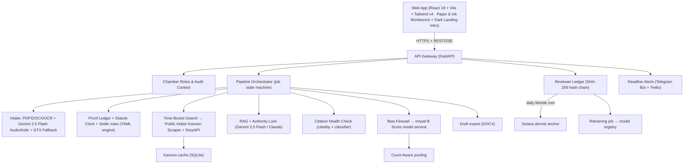

# Insaaf AI — Hackathon Work Plan (PS 29)

> **Product**: Insaaf AI — a mobile-first SaaS that automates the junior-lawyer workflow: client documents in, verified legal draft out, with precedent search, an outcome score that passes a bias test, and an audit trail for every reviewer decision.
> **Customers**: (1) small law firms & chambers on a monthly SaaS plan, (2) law schools.
> **Status**: Plan drafted Nov 13, 2026 from the team notebook (red = build, blue = build if time, pink = customers), Dhanshri's WhatsApp notes, and mentor guidance (Indian Kanoon API, 4 APIs).

> [!IMPORTANT]
> **Problem statement alignment.** The organisers' PS screenshot is the primary reference, but the image did not reach this session (the earlier link had expired). The table in §1 uses the PS as summarised so far: *semantic precedent search + outcome prediction using public judgments*. Paste the exact PS wording into §1 before the PPT is built, and make sure every PS clause maps to a feature.

---

## Table of Contents
1. [PS → Feature Map](#1-ps--feature-map)
2. [One-Line Pitch & Standout Thesis](#2-one-line-pitch--standout-thesis)
3. [Feature Specs (Build List)](#3-feature-specs-build-list)
4. [System Architecture](#4-system-architecture)
5. [The 4 APIs](#5-the-4-apis)
6. [Team Roles](#6-team-roles)
7. [Timeline](#7-timeline)
8. [Production-Quality Checklist](#8-production-quality-checklist)
9. [Frontend References (Not a Spec)](#9-frontend-references-not-a-spec)
10. [Demo Script](#10-demo-script)
11. [PPT Slide Map with Real-World Examples](#11-ppt-slide-map-with-real-world-examples)
12. [Business Model](#12-business-model)
13. [Judge Q&A Defence](#13-judge-qa-defence)
14. [Fact-Check List Before the PPT](#14-fact-check-list-before-the-ppt)

---

## 1. PS → Feature Map

| PS asks for (replace with exact wording) | Insaaf feature that answers it |
|---|---|
| Semantic search over past judgments / precedents | F3 Time-Boxed Kanoon Search, F8 RAG Pipeline (Authority Lock) |
| Outcome prediction from public judgments | F9 Insaaf AI-B Score (trained model), F10 Court-Aware |
| Use of public judgment data | Public Indian Kanoon Scraper (`indiankanoon.org`) + SerpAPI (`site:indiankanoon.org`) + SQLite Judgment Cache (no paid API token required) |
| (any trust / explainability clause) | F2 Bias Firewall, F7 Citation Health Check, confidence + snippet on every conclusion |
| (any usability / impact clause) | F1 Whole Pipeline (junior-lawyer automation), F6 Settle-or-Fight, F12 Nyaya Queue |

---

## 2. One-Line Pitch & Standout Thesis

**Pitch**: *"Insaaf does a junior lawyer's first draft in minutes, and refuses to write a single legal claim it can't prove."*

**Why this stands out from the crowd.** Most teams will build "upload case → chatbot → win %". Ours differs in three ways a judge can see on the phone:

1. **It proves every claim.** Each sentence links to a real judgment paragraph, or says *"No verified authority found."*
2. **It checks whether the law is still alive.** It flags overruled cases and repealed sections (IPC → BNS).
3. **It is tested for bias in front of the judges.** Swap the client to Muslim, Dalit, tribal, female or non-English-speaking, and the score must not move.

**Features that do NOT count as standouts** (any team can get these from ChatGPT in two minutes): summarising a judgment, a chat screen, plain translation, plain draft generation, an LLM-guessed win percentage. We use these as internal steps only and never pitch them as features.

---

## 3. Feature Specs (Build List)

Legend: 🔴 = notebook "Final Features" (build) · 🔵 = "Extra Features" (build if time) · ⭐ = a standout feature to show in the demo and PPT.

> [!NOTE]
> **Statute Clock** (limitation deadlines) is not in the final red list, but F6 and F12 both need deadlines. It is built as a stage inside F1 and feeds those two features.

---

### F1 🔴 Whole Pipeline — "Matter → Verified Draft"

**What**: One orchestrated flow that turns a matter into a reviewed draft.
```text
Intake → Fact Card → Proof Ledger → Statute Clock → Precedent Search → RAG + Authority Lock
→ Citation Health → Insaaf B Score (behind Bias Firewall) → Settle-or-Fight → Draft → Lawyer review
```

**How**:
- Backend state machine (one job per matter). Each stage writes typed JSON to Postgres.
- The app subscribes to progress over SSE/WebSocket, so stages light up live on the phone.
- Stages are resumable: if one stage fails, retry that stage only.
- Draft types for the MVP: **legal notice** and **plaint**, exported to DOCX.

**Statute Clock stage**: deterministic limitation calculator (Limitation Act articles for the chosen case type), forum and court level, and deadline alerts.

**Real-world example for the PPT**:
- *Mata v. Avianca* (S.D.N.Y., 2023): lawyers filed a ChatGPT-written brief citing six cases that did not exist and were sanctioned ($5,000).
- Our pipeline exists so that this cannot happen.

**Done when**: a fictional matter goes from upload to an exported DOCX draft on a real phone, with every stage visible.

---

### F2 🔴⭐ Bias Firewall

**What**: Identity can never change a legal assessment. The app proves it live.

**How**:
1. **Mask**: before any scoring, NER strips or replaces names, caste-coded surnames, religion, gender, tribe, and language markers.
2. **Counterfactual flip test**: re-run the score with the claimant set to six identities (baseline, Muslim, Dalit, tribal, female, non-English-speaking; Dhanshri's list).
3. **Gate**: if `max |S − S_swap| > ε` (e.g. 0.02), the score is **not released**. The app shows "Bias check failed: abstaining" and logs it.
4. Run the same check on the generated reasoning text, not just the number.

**Real-world examples for the PPT**:
- **COMPAS / ProPublica "Machine Bias" (2016)**: Black defendants who did not reoffend were almost twice as likely as white defendants to be labelled high-risk. The tool was used in sentencing; *State v. Loomis* (Wisconsin Supreme Court, 2016) allowed its use with warnings.
  > [!CAUTION]
  > Use this instead of the "Oxford case, one guy died" note. That story doesn't match any documented case; a wrong anecdote destroys an ethics pitch in Q&A.
- **Amazon's recruiting model (scrapped 2018)**: it learned to downgrade CVs containing "women's".
- **Kanak's IndoCentric AI Bias Benchmark**: reasoning models flipped decisions on marginalised groups in Indian legal/institutional scenarios up to **41.67%** of the time. This is our own evidence that the problem exists in India.

**Done when**: on stage, a judge picks an identity, the score holds, and the six-identity table renders.

---

### F3 🔴⭐ Time-Boxed Kanoon Search — "50 million → 20"

**What**: precedent search that costs the same no matter how big the corpus is — running with **zero paid API tokens**.

**How**:
1. The query planner turns the Fact Card into 2–3 Kanoon queries (act + section + key facts), with filters for court (`doctypes`), date (`fromdate`) and page number.
2. **3-tier keyless retrieval** (falls back to `api.indiankanoon.org` only if `KANOON_API_TOKEN` is optionally set):
   - **Tier 1 (Free, Keyless)**: Direct public HTML search parsing of `https://indiankanoon.org/search/?formInput=...` and paragraph extraction (`p[id^='p_']`) from `/doc/{doc_id}/` using `BeautifulSoup`.
   - **Tier 2 (SerpAPI Fallback)**: Google search via `SERPAPI_API_KEY` (`site:indiankanoon.org/doc <query>`) if direct scraping returns empty or times out.
   - **Tier 3 (Pre-warmed Local Corpus)**: SQLite `kanoon_cache` + landmark corpus (`Suraj Lamp`, `Patil Automation`, `Registration Act s.17`, etc.) for deterministic offline replay.
3. Fetch at most **20 judgments**, rerank with legal relevance → top 5 for the RAG stage.
4. **Hard time budget** (e.g. 8 seconds) with async fetch + timeout. Return the best results so far, labelled "searched 20 of N matches".
5. Cache every Kanoon response in SQLite (`insaaf.db`). The demo runs fully from cache if the network fails.

**Real-world example for the PPT**:
- India has **5 crore+ pending cases** (National Judicial Data Grid).
- No team can embed every judgment in India over a weekend. We don't need to: Kanoon already indexes it, so we only fetch 20.
- Line: *"Whether the corpus is 50 thousand or 50 million, every query costs the same 8 seconds."*

**Done when**: a live query returns its top 5 with paragraphs in under 8 seconds, and the cached replay works offline.

---

### F4 🔴 Matter Intake + Bilingual Fact Card

**What**: accepts the documents a junior actually receives, and turns them into checkable facts.

**How**:
- **Inputs**: PDF (PyMuPDF, with Tesseract OCR fallback for scans), DOCX (python-docx), and voice notes/statements in Konkani, Marathi or Hindi processed via **Gemini 2.5 Flash Multimodal Audio ASR + Devanagari Translation** (`GEMINI_API_KEY` free tier) + free keyless Google Translate GTX fallback (no gated ULCA Bhashini keys required; optional `BHASHINI_*` drop-in supported if present).
- **Each fact card holds**: the statement; status (*alleged / backed by a document / disputed / unknown*); the source span (document + page/para); and, for voice, the original-language quote next to the English translation with a confidence flag.
- **Goa glossary**: deterministic normalization for *mundkar*, *comunidade*, *bhatkar*, Form I & XIV, so neither Gemini nor fallback translation mistranslates local land terms.

**Real-world examples for the PPT**:
- **Konkani** has been in the **Eighth Schedule since 1992** and is Goa's official language. Clients explain disputes in Konkani, but pleadings are in English. That gap is where facts get lost.
- The **Supreme Court built SUVAS** to translate judgments into regional languages. The judiciary itself sees the language gap.

**Done when**: a PDF plus a Konkani clip produce fact cards with source links and bilingual quotes.

---

### F5 🔴⭐ Proof Ledger

**What**: lists the evidence a case still lacks before it's filed.

**How**:
- **Dhanshri authors YAML rule packs** per case type. Each rule: `requirement`, `why (statute/case)`, `how_to_detect`, `severity`.
- The engine evaluates the rules against the Fact Cards and marks each item **Present / Weak / Missing**.
- **Property pack (MVP)**: registered sale deed, stamp duty paid, Form I & XIV, possession proof (electricity/house-tax bills), payment trail, prior notices, witnesses, expert reports (handwriting/signature).
- **The rules are deterministic.** The LLM only helps find the evidence in documents. It never decides whether a requirement applies.

**Real-world examples for the PPT**:
- *Suraj Lamp & Industries v. State of Haryana* (Supreme Court, 2011): property "sold" through GPA/agreement/will does not transfer title; you need a registered conveyance deed.
- Thousands of buyers believed they owned property they didn't.
- The Proof Ledger would flag "no registered sale deed" on day one.
- Supporting law: Registration Act s.17 (compulsory registration) and s.49 (effect of non-registration); Indian Stamp Act s.35 (unstamped instruments inadmissible until duty and penalty are paid).

**Done when**: an uploaded matter with an unregistered agreement turns that line red, with the reason and its source.

---

### F6 🔴⭐ Settle-or-Fight Advisor

**What**: the notebook idea, *"if the case is not winnable, it's better to settle or plea-deal than fight."*

**How**: combines three inputs → **Fight / Mediate / Settle / Plea-bargain-eligible**, with reasons.

**Inputs**:
- the F9 score band;
- Statute Clock status;
- deterministic **eligibility rules**:
  - **Lok Adalat** (Legal Services Authorities Act 1987): the award is final, there is no appeal, and court fees are refunded.
  - **Pre-institution mediation**, s.12A Commercial Courts Act, for commercial disputes.
  - **s.89 CPC** reference to ADR, and the **Mediation Act 2023**.
  - **Plea bargaining** (criminal only; BNSS chapter, formerly CrPC Ch. XXIA): only for offences with a maximum sentence under 7 years. Excluded: offences against women, against children under 14, and socio-economic offences.

> [!WARNING]
> The notebook says "based on past cases of **judges**". Score at **court** level, not by named judge (see F10). France banned judge-level analytics in 2019, and judges will ask about it.

**Real-world examples for the PPT**:
- *Patil Automation v. Rakheja Engineers* (Supreme Court, 2022): s.12A pre-litigation mediation is **mandatory**, and suits filed without it can be rejected. A tool that silently skips this costs the client the case.
- Lok Adalat settlement: final, no appeal, fee refunded. A strong option for weak-scoring cases.

**Done when**: a weak-score property matter gets "Mediate / Lok Adalat" with the statute behind it, and a criminal demo matter shows the plea-bargaining eligibility check.

---

### F7 🔴⭐ Citation Health Check

**What**: Dhanshri's rule: check whether each cited case is still valid, overruled, distinguished or limited.

**How**:
1. For each cited judgment, search via the keyless 3-tier Kanoon client (`indiankanoon.org` HTML + SerpAPI `site:indiankanoon.org/doc` + SQLite `kanoon_cache`) for later judgments that cite it (`citedby:` query), filtered to the same or higher courts.
2. Pull the citing paragraph directly from `/doc/{doc_id}/` (`p[id^='p_']` parsing) or cache.
3. **Classify the treatment** in two layers:
   - rule layer: phrases like "overruled", "no longer good law", "per incuriam", "distinguishable on facts", "followed";
   - LLM verification of the label, which must quote the paragraph.
4. Badge: 🟢 followed · 🟡 distinguished / limited · 🔴 overruled. A red badge blocks the citation from the draft unless the lawyer overrides it, and the override is logged in F11.

**Real-world examples for the PPT**:
- *Suresh Kumar Koushal* (2013) was overruled by *Navtej Singh Johar* (2018). A draft citing Koushal today is wrong.
- *ADM Jabalpur* (1976) was overruled by *K.S. Puttaswamy* (2017).
- Line: *"ChatGPT will happily cite a case the Supreme Court overruled. Insaaf turns it red."*

**Done when**: citing Koushal in a demo draft shows a red badge with the Navtej paragraph.

---

### F8 🔴 RAG Pipeline + Authority Lock + Confidence & Snippet

**What**: the reasoning layer, held to Dhanshri's first rule: *every legal assertion must link to a verified judgment, statute, rule, notification or amendment.*

**How**:
- **Chunking**: by rhetorical role (facts / issues / arguments / ratio / decision; OpenNyAI-style). Statutes come from bare-act text (India Code).
- **Retrieval**: hybrid BM25 + embeddings over the F3 results plus the statute corpus.
- **Generation**: the LLM must emit structured JSON where every sentence carries a `source_id + paragraph` reference.
- **Authority Lock (post-check)**: each quoted span must match the stored source text exactly after normalisation. A sentence without a match is removed and replaced with **"No verified authority found."**
- **Confidence + snippet**: every conclusion shows a band (High / Medium / Low, from retrieval score × treatment badge × agreement across sources) and the exact source paragraph beside it.

**Real-world examples for the PPT**:
- *Mata v. Avianca* (2023): fabricated citations.
- In 2023 a **Punjab & Haryana High Court** judge asked ChatGPT for a general view on bail jurisprudence and noted it in the order. Courts are already touching these tools, so verification matters.

**Done when**: a judge types a fake citation into the draft, and the Authority Lock rejects it on screen.

---

### F9 🔴⭐ Insaaf AI-B Score (Trained Model)

**What**: outcome prediction trained on real judgments. **B = bias-adjusted**: the score is released only after the F2 firewall passes.

**How**:
- **Data**: about 1,500 judgments in the chosen category (property / civil recovery), fetched via Kanoon.
- **Labels**: outcome (decreed / dismissed / partly) from the final order via regex + LLM. **Hand-check 100** and report the label accuracy.
- **Features**: Proof Ledger completeness, limitation status, court level, relief type, outcomes of similar precedents weighted by similarity, InLegalBERT document embedding.
- **Model**: logistic regression or LightGBM + SHAP factor bars. Calibrate with isotonic/Platt.
- **Output**: a band (Strong / Uncertain / Weak) + the top factors + **"correct on X of Y unseen cases"** + a calibration plot. Never a bare LLM percentage.
- **Honest limit**: reported judgments over-represent contested and appealed cases. Say so on the model card.

**Real-world example for the PPT**:
- Lex Machina, Premonition, Blue J and the other tools in the reference video are **US-only and English-only**.
- That video also notes Blue J gets accuracy from a **narrow domain**, which is why we scope to property/civil first.

**Done when**: an eval table (accuracy, Brier score, calibration plot) is in the README and on a PPT slide.

---

### F10 🔴 Court-Aware Tuning (the notebook's "location-based judgment")

**What**: adjusts the score for the court the matter will be filed in, without trusting tiny samples.

**How**:
- Hierarchical partial pooling, **district → High Court → national**:

$$\hat p_{court} = \frac{n \cdot \bar p_{court} + k \cdot \hat p_{parent}}{n + k}$$

- A district with 12 judgments borrows strength from the state level, so it can't produce a wild score.
- **Court level only, never named judges.**

**Real-world examples for the PPT**:
- **France (2019)** criminalised publishing analytics that profile individual judges.
- Goa's courts sit under the **Bombay High Court (Goa bench)**. Our pooling follows that real hierarchy.

**Done when**: switching the forum (Goa district → Bombay HC) visibly shifts the score, with the pooling explanation shown.

---

### F11 🔴⭐ Chamber Workspace — Encryption + Tamper-Evident Ledger

**What**: the notebook's "organisation-level architecture": people divided by role inside the organisation; data encrypted, but access *not hidden*.

**How**:
- **Organisations and roles**: Senior Advocate, Junior, Clerk, Student (law-school tier). Enforced with Postgres row-level security keyed on `org_id` (e.g. Supabase Auth + RLS).
- **Encryption**: per-org data keys (envelope encryption), with client documents encrypted at rest. Secrets are never shipped in the app; the server proxies every API call.
- **Reviewer Ledger** (Dhanshri's rule: track reviewer identity, changes, approval time and disagreement reasons):
  - every action is a row: `actor, role, matter, diff, timestamp, reason_code, free_text`;
  - **hash chain**: each row stores `sha256(prev_hash + payload)`, so editing history breaks the chain visibly;
  - **blockchain, done sensibly**: once a day the Merkle root of the ledger is anchored as a memo on **Solana devnet**. That gives public, tamper-evident proof without putting client data on-chain. Kanak's ChainPaws win is Solana experience to reuse here.
- **"Not hidden"**: every org member can see who accessed which matter and when.

**Real-world examples for the PPT**:
- The **Digital Personal Data Protection Act, 2023** puts duties on anyone processing client personal data.
- Advocate–client privilege (Bharatiya Sakshya Adhiniyam, formerly Evidence Act s.126) means a legal SaaS must prove who saw what.

**Done when**: two logins with different roles see different matters, the ledger shows a reviewer's edit with its reason, and editing a past row in the DB turns the chain red.

---

### F12 🔴 Nyaya Queue (DBM Priority)

**What**: the chamber's matters ranked so the urgent one is read first.

**How**:
- Priority score:

$$P = \alpha \cdot \frac{1}{\text{days to deadline}} + \beta \cdot \text{stakes} + \gamma \cdot (1 - \text{proof completeness})$$

- Kept in a binary heap (or an ordered Postgres view).
- Push notifications at T−30, T−7 and T−1 days.
- Urgency flags: undertrial custody, senior-citizen client, interim relief needed.

**Real-world examples for the PPT**:
- During COVID the Supreme Court **excluded 15 March 2020 – 28 February 2022** from limitation (suo motu order). A deadline engine must handle real-world exceptions like this, so make it a test case.
- **35 lakh+ cheque-bounce (s.138 NI Act) cases** were pending when the Supreme Court took suo motu cognisance in 2020–21. Chambers drown in deadline-driven matters.

**Done when**: three demo matters re-order live as deadlines change, and a push notification lands on the phone.

---

### F13 🔴 Disagreement → Retraining Loop

**What**: every time a senior overrides Insaaf, the model learns.

**How**:
- Override reason codes: *wrong fact*, *wrong law*, *wrong citation treatment*, *score disagree*, *bias concern*. They are stored in the F11 ledger.
- Labels table → retraining job (a nightly cron in production; a "Retrain" button in the demo) → model version bump → before/after metrics shown.
- **Privacy**: retraining on an org's data is opt-in only. The default is global retraining on public judgments.

**Real-world example for the PPT**:
- Human-in-the-loop is where Indian courts are heading. The **Kerala High Court's 2025 AI policy** restricts AI in judicial decision-making and requires human oversight. *(Verify wording before the PPT.)*

**Done when**: three overrides followed by Retrain show the new model version and the metric delta.

---

### F14 🔵 Law Change Radar (if time)

**What**: flags outdated law in any uploaded or generated draft (Dhanshri's rule).

**How**:
- Mapping tables: IPC → BNS, CrPC → BNSS, Evidence Act → BSA.
- Offence-date logic: offences before **1 July 2024** stay under the old codes; offences after it need the new codes.
- Amendment watch: Kanoon search by statute name and `fromdate`.

**Real-world example for the PPT**:
- **IPC 302 (murder) → BNS 103.** A draft for a 2025 offence that cites IPC 302 is wrong. Insaaf flags it and suggests BNS 103.

**Done when**: uploading an old-code draft highlights each section with its replacement.

---

## 4. System Architecture



**Implemented web & backend stack**:

| Layer | Implemented stack |
|---|---|
| Web UI | React 19 + TypeScript + Vite + Tailwind v4 (`editorial-tactile-ui`: Paper & Ink legal workbench + dark cinematic landing website with Lady Justice SVG intro) |
| Backend | FastAPI (Python): pipeline orchestrator, 3-tier keyless Kanoon client, Gemini 2.5 Flash multimodal Indic ASR, PyMuPDF / python-docx parsing |
| Data | SQLite (`insaaf.db`) with `kanoon_cache`, hash-chained `ledger_entries`, and YAML legal rule packs (`rules/`) |
| Model | scikit-learn / LightGBM + SHAP + hierarchical Court-Aware pooling |

---

## 5. The 4 APIs (Zero-Blocker Free Stack)

| # | API / Provider | Role | Paid Key Required? | Fallback if network fails |
|---|---|---|---|---|
| 1 | **Public Indian Kanoon Scraper + SerpAPI (`site:indiankanoon.org/doc`)** *(replaces paid `KANOON_API_TOKEN`)* | precedent search, `/doc/{id}/` paragraph extraction, `citedby` lookup | **No** (`indiankanoon.org` HTML is free; `SERPAPI_API_KEY` free tier fallback) | SQLite `kanoon_cache` + `LANDMARK_DOCS` corpus replay |
| 2 | **LLM API** (Gemini 2.5 Flash / Flash-Lite + Concentrate Claude) | structured extraction, constrained drafting, treatment-label verification | **No** (Google AI Studio free tier) | deterministic regex/template stage outputs |
| 3 | **Gemini 2.5 Flash Multimodal Audio + Keyless GTX Indic** *(replaces gated `BHASHINI_*` keys)* | Konkani/Marathi/Hindi voice ASR, Devanagari translation + Goa Land Glossary | **No** (free tier via `GEMINI_API_KEY` + keyless `translate.googleapis.com` GTX) | Goa glossary + pre-transcribed fixture |
| 4 | **Telegram Bot API (`@BotFather`) + Twilio Sandbox + Solana Devnet RPC** | Statute Clock T−30/T−7/T−1 alerts + daily Merkle root ledger anchoring | **No** (all free on devnet / bot token) | in-app alert banner + local SHA-256 hash chain |

> [!TIP]
> You do **not** need `KANOON_API_TOKEN`, `BHASHINI_USER_ID`, or `BHASHINI_API_KEY`. Leave them blank in `backend/.env`—Tier 1/2/3 Kanoon search and Gemini 2.5 Flash + GTX Konkani/Marathi/Hindi audio/text translation activate automatically and cache every fetched paragraph in SQLite (`insaaf.db`).

---

## 6. Team Roles

| Role | Owns | Suggested owner |
|---|---|---|
| **Mobile lead** | app shell, auth, all screens, animations, offline/demo mode, APK | — |
| **Backend & retrieval** | orchestrator, Kanoon client + cache, F3, F8 Authority Lock, F7, ledger hash chain | — |
| **ML lead** | dataset + labels, F9 model + calibration, F2 firewall, F10 pooling, F13 retrain, eval suite | Kanak (bias benchmark experience) |
| **Legal & product** | F5/F6/Statute Clock YAML rule packs, demo matters, label checking, PPT, legal accuracy of every slide | Dhanshri |

---

## 7. Timeline

> [!WARNING]
> Check the hackathon rules on **pre-built code**. Research, data collection, rule authoring and design are almost always allowed before the event; application code often isn't.

### Phase 0 — Before the event (allowed prep only)
- [ ] Paste the exact PS into §1; finalise the PS → feature map.
- [ ] Configure free API keys (`GEMINI_API_KEY`, `SERPAPI_API_KEY`, `TELEGRAM_BOT_TOKEN`) in `backend/.env` and warm the SQLite `kanoon_cache` via Public Indian Kanoon Scraper (`kanoon_client.warm_landmark_cache()`).
- [ ] Dhanshri drafts the YAML rule packs: Proof Ledger (property), Statute Clock (limitation articles), Settle-or-Fight eligibility.
- [ ] Write 3 fictional demo matters (property-strong, property-weak, criminal/plea-eligible), each with PDF/DOCX + a Konkani voice clip.
- [ ] Moodboard + screen list (§9); pick the animation library.
- [ ] Fact-check every example in §14.

### Event plan (36 h; for 24 h, apply the compression notes)

| Hours | Mobile | Backend & retrieval | ML | Legal & product |
|---|---|---|---|---|
| 0–3 | screen map, nav skeleton, design tokens | schemas, API contracts, repo, CI | label scheme, data pull script | freeze demo matters + rules |
| 3–10 | auth, org, matter list, intake upload | Kanoon client + cache, F3 time-boxed search | pull + label judgments, baseline model | F5 rule engine tests, hand-check labels |
| 10–18 | live pipeline screen (SSE), fact cards | orchestrator, F8 RAG + Authority Lock | F2 Bias Firewall, F9 calibration + SHAP | Statute Clock rules, F6 rules |
| 18–24 | score, proof and citation screens | F7 Citation Health, ledger hash chain | F10 pooling, eval suite | draft templates (notice, plaint) |
| 24–30 | Nyaya Queue, reviewer flow, push | DOCX export, Solana anchor, `/health/deep` | F13 retrain button | F14 Law Change Radar tables (if time) |
| 30–34 | polish, offline/demo mode, APK build | load test, cache warm-up | final eval numbers → README | PPT + demo video |
| 34–36 | **freeze** | **freeze** | **freeze** | rehearse 3× with timer |

**24-hour compression**:
- F10 → a single pooled constant per court level.
- F13 → the Retrain button only.
- F14 → drop.
- Solana anchor → drop (keep the local hash chain).

---

## 8. Production-Quality Checklist

- [ ] TypeScript strict; Python typed (pydantic models for every stage output).
- [ ] No secrets in the app bundle; all API calls go through the backend.
- [ ] Every screen has loading, empty, error and offline states. Nothing spins forever.
- [ ] **Demo mode**: if any API fails, stages replay from cache, labelled "cached".
- [ ] `/health/deep` endpoint: Kanoon (public scraper + SerpAPI), LLM, Gemini Audio/Indic GTX, DB, model version.
- [ ] Golden eval suite (30 cases): fact-source accuracy, Authority Lock rejection, citation treatment, firewall Δ, score accuracy. Results table in the README.
- [ ] Tests: rule engines (Proof Ledger, Statute Clock incl. the COVID exclusion window), hash chain, RLS isolation.
- [ ] Accessibility: dynamic type, contrast, screen-reader labels. Devanagari fonts for Konkani/Marathi/Hindi (e.g. Noto Sans Devanagari).
- [ ] Error monitoring (e.g. Sentry); CI on every push.
- [ ] Judge access: APK via QR **and** a recorded walkthrough; never depend on judges installing anything.

---

## 9. Frontend References (Not a Spec)

These are inspirations, not layouts. Build your own look.

**Reference apps, mapped to what to borrow**:

| Insaaf screen | Look at | Borrow the idea of |
|---|---|---|
| Matter list | Apple Wallet, CRED | stacked tactile cards; a premium Indian product feel |
| Live pipeline | Arc Search "Browse for me", Perplexity app | results streaming in stage by stage |
| Draft + citations | Perplexity app, Notion | inline citation chips that expand to the source |
| Statute Clock | Apple Fitness rings, Apple Health | countdown as a ring or timeline, not a number |
| Proof Ledger | Things 3, Linear | a calm checklist with clear states |
| Insaaf B Score | Robinhood, Apple Weather | one big number band + "why" factors underneath |
| Bias Firewall | Apple Weather's hourly strip | six identities side by side, one flat line |
| Reviewer flow | GitHub mobile PR review | diff → comment → approve, with a reason |
| Nyaya Queue | Things 3 Today, Linear inbox | triage list with urgency |

**Galleries**: Mobbin (real app screens by pattern), Refero, Dribbble/Behance ("legal app", "case management").

**Motion and rendering libraries (React Native)**:
- Reanimated 3 + Moti for transitions;
- react-native-skia for custom rings and charts;
- Rive or Lottie for hero moments (e.g. the Authority Lock rejecting a citation, the firewall check passing).

**Kanak's own UI skills** (in his private learning repo; ask him for a copy; written for the web, but the principles carry): `editorial-tactile-ui` (paper and ink, analog depth, typography first) and `dynamic-ui-craft` (don't design from a blank canvas; start from curated components).

**Make these moments look special**: they win the room. Spend polish here first.
1. The pipeline stages lighting up live.
2. The Authority Lock rejecting a fake citation.
3. The six-identity Bias Firewall line staying flat.
4. A citation badge turning red (overruled).
5. The Statute Clock counting down.

---

## 10. Demo Script (3 min)

| Time | Beat | Feature |
|---|---|---|
| 0:00 | Hook: "5 crore pending cases. A junior advocate in Margao just got a client's Konkani voice note and a stack of PDFs." | — |
| 0:15 | Upload PDF + Konkani clip; fact cards appear with the original quote next to the translation | F4 |
| 0:35 | Proof Ledger: "No registered sale deed" goes red (*Suraj Lamp*) | F5 |
| 0:50 | Kanoon search: 8-second ring, "20 of 4,000+ searched", top 5 paragraphs | F3 |
| 1:10 | Draft streams in; tap a citation and the source paragraph opens | F8 |
| 1:25 | **Judge types a fake citation → Authority Lock: "No verified authority found."** | F8 ⭐ |
| 1:40 | Draft cites *Koushal* → red badge, *Navtej* paragraph shown | F7 ⭐ |
| 1:55 | Insaaf B Score: Weak band + factors + "correct on X/Y unseen cases" | F9 |
| 2:10 | **Judge swaps the claimant identity → line stays flat** | F2 ⭐ |
| 2:25 | Settle-or-Fight: "Mediate / Lok Adalat", with the statute | F6 |
| 2:35 | Senior overrides one item with a reason → ledger entry; chain verified | F11 / F13 |
| 2:50 | Close: *"Insaaf writes the first draft, and refuses to write a claim it can't prove."* | — |

---

## 11. PPT Slide Map with Real-World Examples

| # | Slide | Real-world anchor |
|---|---|---|
| 1 | Hook | 5 crore+ pending cases (NJDG); 35 lakh+ cheque-bounce cases (SC suo motu, 2020–21) |
| 2 | The PS → our answer | §1 map |
| 3 | Why not just ChatGPT? | *Mata v. Avianca* (2023): six fake cases, sanctions |
| 4 | The pipeline | junior-lawyer workflow, input → output |
| 5 | Bias Firewall | COMPAS / ProPublica 2016; Amazon 2018; IndoCentric benchmark 41.67% |
| 6 | Citation Health | *Koushal* (2013) → *Navtej Johar* (2018); *ADM Jabalpur* → *Puttaswamy* (2017) |
| 7 | Proof Ledger | *Suraj Lamp* (2011): GPA sales don't transfer title |
| 8 | Settle-or-Fight | *Patil Automation* (2022): s.12A mediation mandatory; Lok Adalat finality |
| 9 | Score + Court-Aware | France 2019 judge-analytics ban; why court-level; calibration plot |
| 10 | Language gap | Konkani in the 8th Schedule (1992); SC's SUVAS translation tool |
| 11 | Chamber + Ledger | DPDP Act 2023; advocate–client privilege; Solana-anchored ledger |
| 12 | Law Change Radar | IPC → BNS from 1 July 2024; IPC 302 → BNS 103 |
| 13 | Competition | US tools from the video (Lex Machina, Premonition, Blue J…: US-only, English); India: CaseMine, Indian Kanoon Prism, SC's SUPACE |
| 14 | Business model | §12 |
| 15 | Eval results | golden suite table, model accuracy + calibration |
| 16 | Roadmap + close | more case types, more languages, court-filing integrations |

Use the reference podcast (Mitch Jackson, *AI in Law*) only for the framing *"augmentation, not replacement"* and *"settle vs trial decisions."* Do **not** borrow its jury, demographics or public-sentiment factors: India has no jury trials, and demographic factors contradict our Bias Firewall.

---

## 12. Business Model

Pricing is a set of hypotheses to validate, not findings.

| Tier | Customer | What they get | Price hypothesis |
|---|---|---|---|
| Student | law-school students (moot prep) | pipeline on public cases, Authority Lock checks their drafts | institutional licence or ~₹199/mo |
| Solo | independent junior advocate | full pipeline, 1 seat | ~₹999/mo |
| Chamber | 2–10 lawyer chambers | roles, ledger, Nyaya Queue, retraining on their own overrides | ~₹2,499/seat/mo |
| Firm / Institution | larger firms, legal-aid bodies, law schools | custom data residency, SSO | custom |

**Law-school angle**: "Moot Mode". Students draft, and Insaaf checks citations, outdated law and missing proof, so it works as a teaching tool too.

---

## 13. Judge Q&A Defence

| Question | Answer |
|---|---|
| "How is this different from CaseMine / Indian Kanoon Prism?" | "They help you find cases. We automate the junior's whole first pass and refuse any claim we can't prove, including checking whether a cited case is still good law and whether the section has been replaced by BNS." |
| "Can you really predict outcomes?" | "We predict a band for one narrow case type, with held-out accuracy and a calibration plot on screen. We never show a fake-precise percentage." |
| "What about bias?" | "Try it: pick any identity. If the score moves more than ε, we refuse to answer." |
| "How do you handle 50 million cases?" | "We don't index them; Kanoon does. We fetch 20 under a fixed time budget, so cost doesn't grow with the corpus." |
| "Why blockchain?" | "Only the daily hash of the audit log goes on-chain, as tamper-evidence. Client data never does." |
| "Is this legal advice?" | "No. It's a drafting and research assistant for advocates. Every draft is watermarked and needs a lawyer's approval, which is logged." |
| "Judge analytics?" | "Court-level only. France banned judge profiling in 2019, and we agree with the reasoning." |

---

## 14. Fact-Check List Before the PPT

Verify each item against a primary source before it goes on a slide; Dhanshri should sign off on the legal ones.

- [ ] NJDG pending-case total (current figure and date)
- [ ] s.138 NI Act pending count (SC suo motu 2020–21)
- [ ] *Mata v. Avianca*: sanction amount and date
- [ ] COMPAS / ProPublica figures; *State v. Loomis* holding
- [ ] *Suraj Lamp & Industries v. State of Haryana*: year and holding
- [ ] *Patil Automation v. Rakheja Engineers* (2022): s.12A holding
- [ ] *Koushal* → *Navtej*; *ADM Jabalpur* → *Puttaswamy*: wording ("overruled")
- [ ] IPC 302 → BNS 103 and any other mapping you show
- [ ] Plea-bargaining eligibility under BNSS (chapter and section numbers)
- [ ] Lok Adalat: finality and fee-refund provisions (LSA Act section numbers)
- [ ] BSA section for advocate–client privilege
- [ ] Kerala HC 2025 AI policy wording
- [ ] P&H HC 2023 ChatGPT bail order details
- [ ] France 2019 judge-analytics provision
- [ ] Public Indian Kanoon `/search/` + `/doc/{id}/` HTML structure, `citedby:` operator, SerpAPI fallback
- [ ] Gemini 2.5 Flash Konkani/Marathi/Hindi ASR & translation + Goa Land Glossary accuracy
